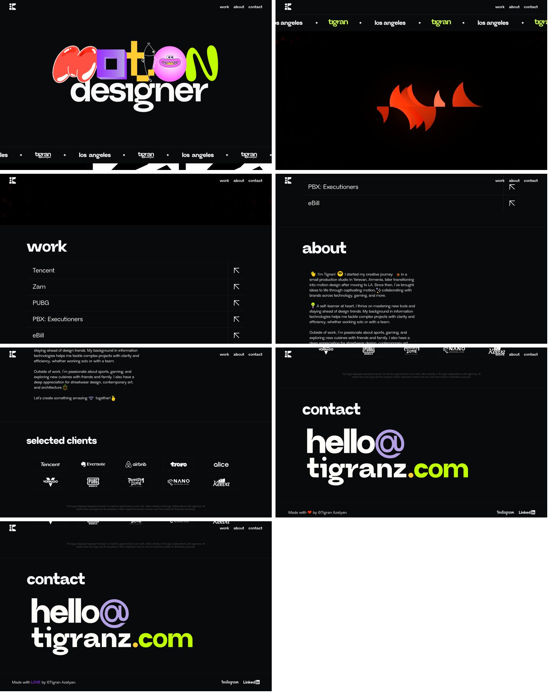
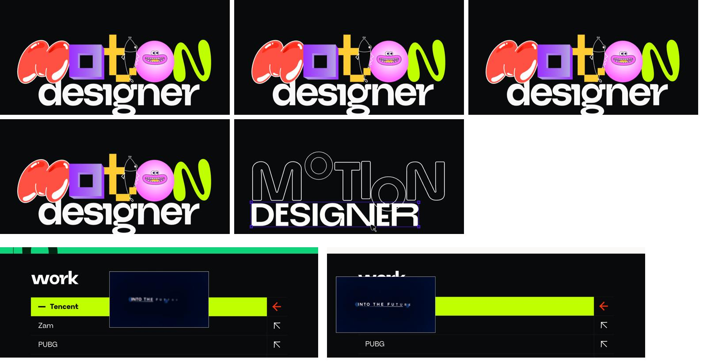
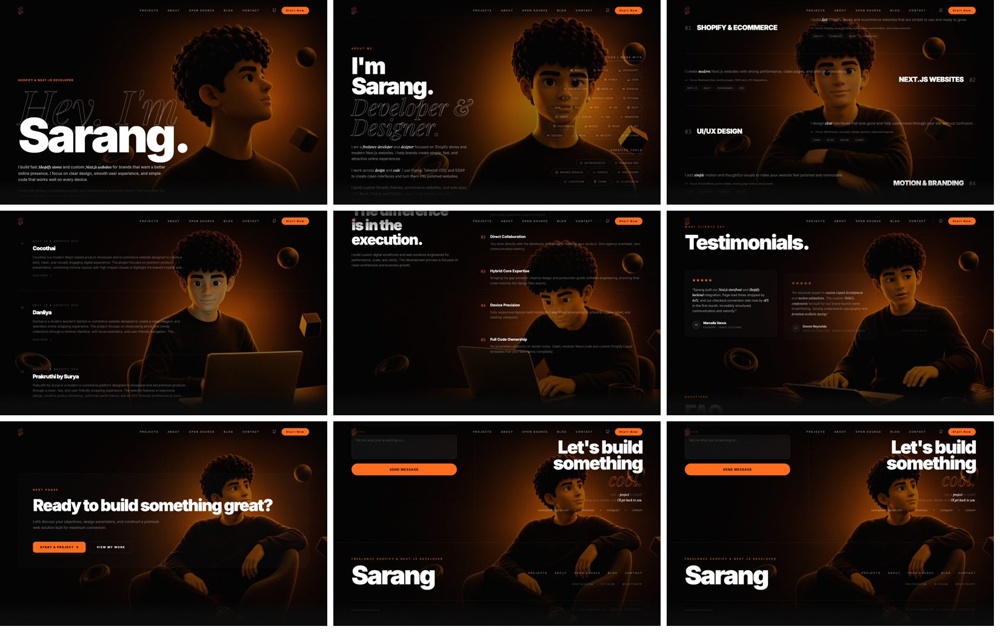
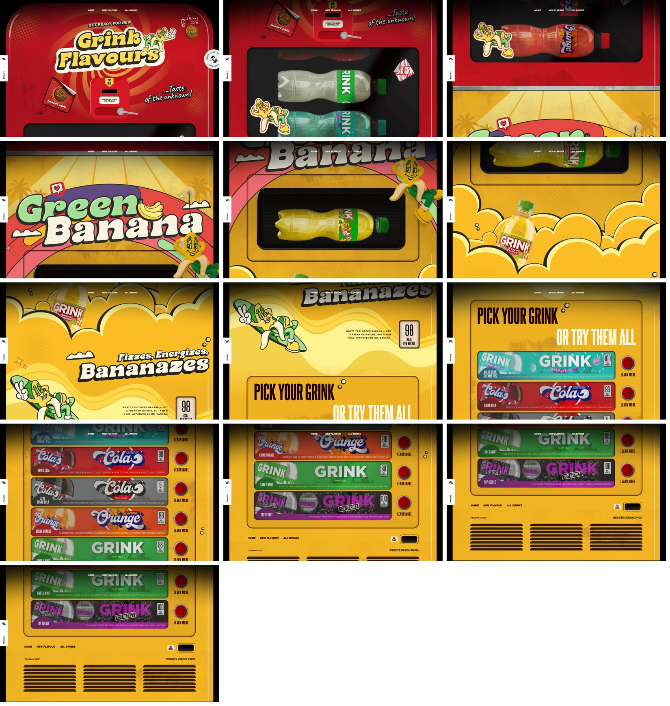

# Reference sites: what makes them work

Reverse-engineered on 2026-10-13 by visiting each site in a real browser, scrolling through it,
testing hovers and interactions, and inspecting the code (framework, libraries, fonts, media).
Screenshots in `img/` are for private reference only; they belong to their owners.

| | **tigranz.com** | **sarang-space.site** | **grink2025.dviga.marketing** |
|---|---|---|---|
| What it is | Motion designer portfolio | Freelance developer portfolio | Drink brand promo (award-winning) |
| Built with | Framer + **Rive** | **Next.js** + Lenis + GSAP + Framer Motion + Three.js | **Tilda** + **GSAP ScrollTrigger** |
| The one big idea | Playful, hand-made motion everywhere: the site *is* the showreel | A 3D version of the developer *acts out* the story as you scroll | The whole page *is* a vending machine |
| Signature technique | Hover reveals "how it's made" | Scroll-scrubbed video (with a reversed copy) | Interaction-gated intro + scroll-driven product drop |
| Mood | Dark, bold, toy-like colour | Dark, cinematic, single warm accent | Loud, retro, maximal |

---

## How these designers think (the part worth learning)

The designs themselves aren't the lesson; the decisions behind them are. All three follow the
same thinking:

1. **Start from a true thing, not a style.** Tigran's truth is "I make things move", so everything
   moves. Sarang's is "you'll be working with me", so he's on screen the whole time. Grink's is
   "it's a drink from a machine", so the page is the machine. The look comes *after* the truth.
2. **Turn your core verb into the interaction.** Tigran animates, so his hover *reveals how it's
   animated*. Sarang builds, so you *watch him build* as you scroll. Grink is bought, so you *insert
   a coin*. The visitor experiences the verb instead of reading about it.
3. **One idea, many expressions.** Every section restates the same idea in different clothes.
   That repetition is what makes a site feel "designed" rather than assembled.
4. **Spend boldly on a few signature moments, keep the rest quiet.** Each site has two or three
   unforgettable moments; everything between them is calm and simple.
5. **Design the edges.** People remember the first seconds and the last screen most (the
   peak-end effect). The hero and the footer get the most care; footers are destinations.
6. **Give the visitor something to do.** Hover, drag, scroll-to-reveal: a small action creates
   memory and a sense of play.
7. **Show the real thing.** The process (Tigran), the person (Sarang), the product (Grink).
   Authenticity reads as premium; stock gloss reads as template.
8. **Use constraint as style.** One display font (Tigran), one accent colour (Sarang), one object
   (Grink). Limits create a recognisable identity.

The rest of this document is the technical teardown: useful for *how* to build things, not for
*what* to build.

---

## 1. tigranz.com: personality through motion

**Anatomy, top to bottom**
1. **Hero:** "Motion designer" spelled with toy-like 3D letters (a glossy blob M, a purple cube O, a fish
   T, a pink face). Nothing else on screen.
2. **Ticker:** a looping marquee ("tigran ✦ los angeles ✦ …") in a strip.
3. **Showreel:** an abstract animated piece (red shapes), full width.
4. **Work:** a plain list of client names, one row each, with an arrow.
5. **About:** a short, warm bio with small animated icons dropped inline between words (👋 ✨ 💡 🔥).
6. **Selected clients:** a logo wall, where every logo is a tiny animation.
7. **Contact/footer:** the email address *is* the footer, set enormous: **hello@tigranz.com**.

**Techniques (and how they're built)**
- **Rive everywhere.** Every animated element is a `.riv` file: the hero, each nav item
  (`nav_work.riv`), each client logo (`tencent.riv`, `pubg.riv`). Rive files are tiny, crisp at
  any size, and interactive (state machines respond to hover and click).
- **Hover reveals the process.** Hovering the hero swaps the finished 3D letters for a wireframe
  "design tool" view: outlined letters, a selection box, a cursor. It shows *how the work is made*,
  the perfect flex for a designer. 
- **Rich list hover.** A work row turns lime, its arrow flips and turns red, and a **video preview
  follows the cursor**. A plain list becomes a showreel on demand.
- **Custom cursor** (`cursor: none` plus a drawn cursor).
- **Typography:** one characterful display face (Neue Regrade), mostly lowercase, very large headings
  ("work", "about", "contact") over tiny body text. Strong contrast in scale.

**Why it feels premium:** restraint in layout, maximal care in motion. The page structure is
simple (a list, a bio, logos, an email); every small piece is crafted. Personality shows in the
details, not the layout.

**Watch-outs:** it leans entirely on custom Rive art; without the animations it's a plain list.

---

## 2. sarang-space.site: a character that tells the story

**Anatomy**
1. **Hero:** "Hey, I'm **Sarang**." A huge bold sans with an italic serif ghost line behind it, and a
   3D Pixar-style version of the developer filling the right half, lit with warm orange.
2. **About:** "I'm Sarang. *Developer & Designer*" plus a scattered cloud of tech-stack chips.
3. **Services:** four numbered services (01 to 04), staggered left and right around the character.
4. **Projects:** case-study list; the character is now **at a laptop, working**.
5. **Process ("The difference is in the execution"):** numbered principles.
6. **Testimonials**, **FAQ**, then a **"Ready to build something great?"** call to action.
7. **Contact/footer:** "Let's build something *cool.*" with a message box, then a giant name
   wordmark as the footer.

**Techniques**
- **Scroll-scrubbed video (the key trick).** Two full-screen `<video>` elements sit fixed behind
  the page, **paused**. JavaScript sets `video.currentTime` from scroll progress, so the character's
  pose changes as you scroll (looking out → at the laptop → sitting back). The second video is a
  **reversed copy**: scrubbing a video backwards stutters (browsers decode forwards from keyframes),
  so when you scroll up the site swaps to the reversed file. One 15-second clip drives the whole page.
- **Lenis smooth scrolling** makes scrubbing feel buttery rather than steppy.
- **Single accent colour** (orange) on a near-black page; the lighting in the video matches it, so
  text, UI and character feel like one scene.
- **Typography pairing:** heavy grotesk (Inter, very bold) plus an italic serif (Playfair Display) for
  one or two words per heading ("*Developer & Designer*", "something *cool.*"). It reads as editorial.
- **Numbered sections** (01, 02…) and small mono labels give a designed rhythm.
- **Custom cursor**, plus heavy SEO (structured data, a hidden text summary) because it's a
  business site.

**Why it feels premium:** cinematic continuity. One character, one light source, one accent, and
the story unfolds as you scroll rather than in boxes.

**Watch-outs:** the video is the site; it's heavy for mobile data and depends on a well-made 3D
character clip. The content sections are fairly standard once you look past the backdrop.

---

## 3. grink2025.dviga.marketing: commit to one metaphor

**Anatomy:** the entire page is the front of a vending machine.
1. **Intro:** a red machine with "Insert coin", a coin slot, and "Press the lever and release".
   **Scrolling is locked** (`overflow: hidden`) until you interact. You literally pay to enter.
2. **Dispenser window:** as you scroll, bottles drop through the machine's glass window.
3. **New flavour reveal:** the machine turns **from red to yellow**, "Green Banana", and the mascot
   (Mr. Banana) pops in; the bottle falls out of the dispenser into the next scene.
4. **Product story:** "Fizzes, Energizes, *Bananazes*", the calorie count as a little badge.
5. **Pick your Grink:** every drink is a vending-machine slot with a red push button ("Learn more").
6. **Footer:** the coin-return slot ("Take change") and the machine's air vents.

**Techniques**
- **Interaction-gated intro:** the page won't scroll until you engage, which turns the first
  second into play. (Use sparingly; it's a promo, not a portfolio.)
- **GSAP ScrollTrigger** choreographs everything: the bottle drop, colour change and pinning.
- **Image sequences:** around 70 numbered frames played on scroll (the technique Apple uses on
  product pages) for the bottle motion. That gives video-like motion with exact scroll control.
- **A mascot as the guide** (Mr. Banana), appearing at each beat.
- **Custom cursor image** and award badges (CSSDA "Website of the day") as social proof.

**Why it feels premium:** total commitment. Every section, button and footer is a believable part
of the machine; nothing breaks the metaphor.

**Watch-outs:** loud and maximal by design; built on a no-code builder with a lot of images (about
150), so it's heavy.

---

## What all three share (the 2026 playbook)

1. **One strong concept, carried end to end.** A metaphor (vending machine), a character (Sarang's
   3D self) or a craft signature (Tigran's toy letters). Award winners commit to one idea rather than
   mixing effects.
2. **Motion with meaning.** Movement tells you something: the process (Tigran), the story (Sarang),
   the product (Grink). None of it is decorative particle noise.
3. **Personality is a feature.** A mascot, a self-portrait character, or playful letterforms. Each
   site feels made by *someone*.
4. **The footer is a destination.** Giant email (Tigran), a giant name with a big CTA (Sarang), the
   machine's change slot (Grink). The end of the page is designed, not leftover.
5. **Scale contrast in type.** Huge headings and small, quiet body text. Often one display face
   plus one accent face (an italic serif for emphasis).
6. **Custom cursors and rich hovers.** Small interaction rewards signal craft.
7. **Smooth scroll plus scroll-linked motion.** Lenis or GSAP so scroll-driven motion feels fluid.

## Technique → how we'd build it in our stack (Next.js)

| Technique | Seen on | How we'd do it | Effort |
|---|---|---|---|
| Smooth scrolling | Sarang | `lenis` | Low |
| Scroll-pinned, choreographed sections | Grink | GSAP ScrollTrigger (or Motion `useScroll`) | Medium |
| Scroll-scrubbed video (+ reversed copy) | Sarang | One clip; `ffmpeg -vf reverse` for the reverse file; set `currentTime` from scroll | Medium (needs a good clip) |
| Image sequence on scroll | Grink | Frames on a `<canvas>`, drawn by scroll progress | Medium |
| Kinetic / playful type | Tigran | SVG + Motion, or Rive for hand-made letter animation | Low to High |
| Hover reveals "how it's made" | Tigran | Two layered states, crossfade on hover | Low |
| Cursor-following video preview on list hover | Tigran | Fixed preview element following pointer (Motion springs) | Low |
| Inline animated icons in text | Tigran | Small SVG/Lottie/Rive icons inline | Low |
| Interaction-gated intro | Grink | Lock scroll until a playful action | Low (use sparingly) |
| Giant email/name footer | All | Big display type, magnetic hover | Low |
| Custom cursor | All | A small element following the pointer with blend modes | Low |
| Motion-graphics films for case studies | (our gap) | HyperFrames (HTML → MP4), now connected | Medium |

## Applying the thinking to our site

Our truths (from brainstorming): Debashish **notices everyday frictions**, sees them through **three
lenses** (customer, tech, money), **bootstraps** with what's at hand, and **ships**. The core verb is
the headline itself: *Spot it. Shape it. Ship it.* The disc carousel already says "shipped work".

So the questions for our own design are:
- How does a visitor *experience* spotting, shaping and shipping, rather than read it?
- What's the one idea that the hero, the discs and the footer are all expressions of?
- What are our two or three signature moments, and what stays quiet?
- What does the visitor *do* at the start and the end?
